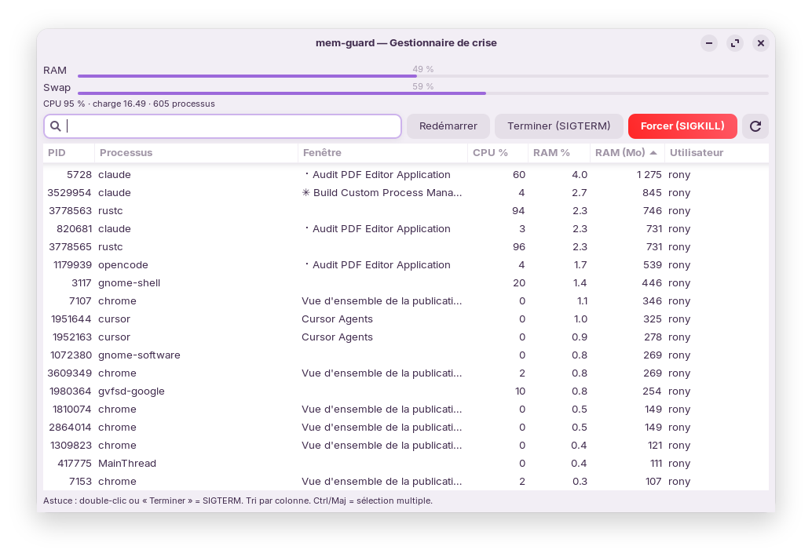

# mem-guard

**Moniteur mémoire + gestionnaire de crise RAM/CPU pour Linux (GNOME / Zorin / X11).**

`mem-guard` surveille la RAM, le swap et la charge en continu, alerte **avant**
le point de non-retour, et fournit un **gestionnaire de processus sur mesure**
pensé pour la gestion de crise : quand le PC sature et thrashe, tu fais surgir
la fenêtre (raccourci clavier), tu repères le process coupable, et tu le tues
ou le redémarres en un clic — l'application elle-même étant **immunisée contre
l'OOM killer** et **prioritaire en CPU** pour rester réactive.



---

## Fonctionnalités

- **Boîte noire mémoire** : log CSV continu (RAM/swap/charge/top process) pour
  analyser un freeze a posteriori, avec rotation automatique.
- **Alertes anti-freeze** : notifications aux seuils RAM élevée / critique /
  swap élevé (cliquables → ouvrent le gestionnaire).
- **Icône de barre des tâches** permanente (AppIndicator), couleur selon la
  sévérité, lancée automatiquement à l'ouverture de session.
- **Gestionnaire de processus** : PID, nom, **titre de fenêtre**, CPU %, RAM %,
  RAM (Mo), utilisateur — triable, filtrable.
- **Résolution précise du titre de fenêtre** (remontée de l'arbre des process) :
  | Contexte | Méthode |
  |---|---|
  | gnome-terminal, Chrome, VS Code / Cursor (Electron) | `_NET_WM_PID` X11 |
  | **kitty** (multi-fenêtres / onglets / splits) | contrôle distant `kitty @ ls` → `onglet › split` |
  | **tmux** (sessions détachées) | `tmux list-panes` → `session:fenêtre` |
- **Actions** : **Terminer** (SIGTERM), **Forcer** (SIGKILL), **Redémarrer**
  (best-effort : capture `cmdline`/`cwd`/`env` avant de tuer, puis relance).
- **Priorité sur tout** : immunité OOM (`oom_score_adj=-1000`), `nice=-5`,
  `CPUWeight`/`IOWeight` max → reste réactif même sous forte pression.
- **Raccourci clavier** (Ctrl+Alt+Suppr) : fait surgir la fenêtre **au-dessus
  de tout**, sans relancer d'interpréteur (D-Bus / SIGUSR1).
- **Instance unique** : pas de double icône.

---

## Installation

### Via le paquet `.deb` (recommandé)

```bash
sudo apt install ./mem-guard_0.0.1_all.deb
```

`apt` installe automatiquement les dépendances et active le service utilisateur
(démarrage à la prochaine session). Pour démarrer tout de suite :

```bash
systemctl --user start mem-guard
```

### Dépendances

`python3`, `python3-gi`, `python3-psutil`, `gir1.2-gtk-3.0`,
`gir1.2-ayatanaappindicator3-0.1` (ou `gir1.2-appindicator3-0.1`), `wmctrl`.

---

## Utilisation

- **Ouvrir** : clic sur l'icône de barre des tâches → « Ouvrir le
  gestionnaire », ou `mem-guard --open`, ou le raccourci Ctrl+Alt+Suppr.
- **Trier** : clic sur un en-tête de colonne (RAM décroissante par défaut).
- **Filtrer** : champ de recherche (nom, fenêtre, PID).
- **Sélection multiple** : Ctrl / Maj.
- **Tuer** : bouton *Terminer* (ou double-clic) ; *Forcer* en dernier recours.
- **Redémarrer** : relance le process avec la même commande/dossier/env.
  ⚠ Un process attaché à un terminal repart **détaché** du terminal.

### Raccourci clavier Ctrl+Alt+Suppr

À lancer **dans ta session graphique** (pas en root) :

```bash
./scripts/setup-shortcut.sh /usr/bin/mem-guard-summon
```

Libère la déconnexion par défaut de GNOME et lie Ctrl+Alt+Suppr à l'ouverture
de mem-guard.

### Immunité OOM (priorité absolue)

Un service `--user` ne peut pas abaisser son propre `oom_score_adj`.
mem-guard le fait au démarrage via `sudo -n` (sudo sans mot de passe). Sans ce
droit, l'app reste fonctionnelle mais sans l'immunité `-1000` (dégradation
silencieuse, pas de plantage).

---

## Construire le `.deb`

```bash
./packaging/build-deb.sh
# -> dist/mem-guard_0.0.1_all.deb
```

---

## Architecture

```
src/mem-guard            Application Python/GTK3 (moniteur + tray + fenêtre)
src/mem-guard-summon     Réveil léger de l'instance (D-Bus → SIGUSR1 → cold start)
systemd/mem-guard.service Service utilisateur (autostart + priorités)
data/mem-guard.desktop   Entrée du menu d'applications
scripts/setup-shortcut.sh Raccourci Ctrl+Alt+Suppr (GNOME, per-user)
packaging/build-deb.sh   Construction du paquet .deb
```

Détails techniques notables :
- **Instance unique** via `Gtk.Application` (l'invocation `--open` transmet à
  l'instance vivante au lieu d'en démarrer une seconde).
- **Continuité CPU %** : les objets `psutil.Process` sont mis en cache entre
  rafraîchissements (sinon `cpu_percent()` renvoie toujours 0).
- **Rafraîchissement** (2 s) **arrêté quand la fenêtre est masquée** : en idle,
  une seule mesure légère toutes les 20 s — un moniteur ne doit jamais
  aggraver la pression mémoire.

---

## Documentation

| Guide | Contenu |
|---|---|
| [docs/INSTALL.md](docs/INSTALL.md) | Installation, raccourci Ctrl+Alt+Suppr, immunité OOM, mapping kitty, désinstallation, migration |
| [docs/DEVELOPMENT.md](docs/DEVELOPMENT.md) | Lancer depuis les sources, **reconstruire le `.deb`**, bumper la version, publier une release, notes de packaging |
| [docs/ARCHITECTURE.md](docs/ARCHITECTURE.md) | Fonctionnement interne : instance unique, boîte noire, résolution des titres de fenêtre (kitty/tmux/X11), priorité OOM/CPU, réveil instantané |
| [CHANGELOG.md](CHANGELOG.md) | Historique des versions |

**Reconstruire le `.deb` après une modif des sources :**

```bash
./packaging/build-deb.sh        # → dist/mem-guard_<version>_all.deb
```

## Licence

[MIT](LICENSE) © 2026 Rony.
